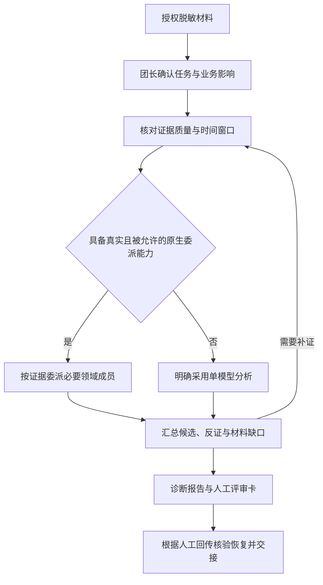

# CRM SRE Team

电信 CRM 稳定性专家团 · `2.8.0-rc6` · Mac 验收候选版

面向电信 CRM 运维场景的 WorkBuddy 专家团项目。基于用户授权的脱敏材料，组织业务链路、数据库、应用运行时和基础设施等领域分析，形成可追溯的诊断结论、最小补证需求、人工评审卡与交接记录。

项目包含角色提示词、领域 Skill、Runbook、输出模板，以及本地构建、校验和发布工具。运行时根据宿主实际能力选择原生专家委派或单模型分析；生产操作由现场人员按独立审批流程处理。

| 项目属性 | 当前状态 |
|---|---|
| 集成形式 | WorkBuddy 专家团插件；提供完整源码与已生成资源 |
| 专业覆盖 | 1 名稳定性总指挥、7 名领域成员、8 个角色 Skill + 1 个团长 BOMC 只读 Skill |
| 分析输入 | 明确授权且已脱敏的日志、指标、调用链、变更记录与业务材料 |
| 执行边界 | 仅团长可经守卫执行本轮用户授权的 BOMC 只读查询；其他生产连接禁止，生产写仅形成人工评审材料 |
| 交付状态 | `2.8.0-rc5` 未发布候选；rc4 Mac 实测已归档，值班机与关口未验证 |

## 适用场景

适用于 CRM 值班分析、跨域故障定位、变更评审和事后复盘。典型任务如下：

| 场景 | 可提供的材料 | 分析重点 |
|---|---|---|
| 接口超时与性能劣化 | 同一时窗的接口指标、调用链、应用日志 | 定位耗时环节，区分资源、数据库与应用侧候选机制 |
| 订单积压与状态异常 | 订单状态、工单、回执、消费记录、对账结果 | 找出业务状态分叉点，判断补偿与数据正确性的核验需求 |
| Oracle 或 JVM 异常 | SQL、执行计划、等待事件、线程栈、GC 与连接池记录 | 在对应专业域内分析机制，并明确跨域转交需求 |
| 变更后异常与恢复评估 | 变更差异、容量趋势、恢复记录、业务验证结果 | 核对变更关联，整理恢复前提、风险和回退评审依据 |

材料不足时先说明可判断的范围，再提出最小补证需求。组织事故分级、现场处置与业务关闭仍由相关责任人决定。

## 专家体系

稳定性总指挥负责影响评估、任务路由、证据汇总、冲突处理和交接。领域成员只对职责范围内、且有材料支持的论断负责。

| 角色 | Skill ID | 主要职责 |
|---|---|---|
| 稳定性总指挥 | `stability-director` | 组织分析、收敛候选、汇编评审材料与交接记录 |
| CRM 业务链路专家 | `crm-business-flow` | 订单状态、接口与批次、幂等、补偿和对账语义 |
| Linux 基础设施专家 | `linux-infra` | CPU、内存、磁盘、网络、进程与时钟相关证据 |
| Oracle 数据库专家 | `oracle-dba` | 会话、等待、阻塞链、SQL、执行计划与空间问题 |
| Java 应用与 JVM 专家 | `java-runtime` | 线程、GC、应用连接池、异常栈与消费端执行 |
| 证据与可观测性专家 | `observability-diagnosis` | 时间线、指标口径、来源质量、证据冲突与反证 |
| 变更容量容灾专家 | `change-capacity-dr` | 变更差异、容量趋势、备份恢复链与方案风险 |
| K8s 辅助专家 | `k8s-platform` | 已确认 K8s 部署且存在相关平台证据时，分析调度、节点与服务网络 |

团长注册 ID 为 `telecom-crm-sre-team-lead`；成员注册与映射以 `.codebuddy-plugin/plugin.json`、`policy-source/roles-source.json` 为准。Agent ID 与 Skill ID 分别用于角色调用和技能加载。

原生模式下，每批最多委派 3 名必要成员。每名成员在一个逻辑任务内至多提出 2 项原子材料请求，团长面向用户每轮合计至多 3 项。成员选择由证据驱动；多名成员意见一致，仍需现场证据支持才能确认根因。

## 分析流程与输出



上述流程描述分析工作的组织方式。原生与兼容模式输出自然语言报告；专用 Harness 的状态机、账本和强制 Schema 属于尚未实现的托管设计。

结论按四类组织：

- 已确认事实：注明材料来源、对象和时间窗口。
- 高概率候选：说明支持证据、反证及关键替代解释；缺少依据时保留为空。
- 待验证：列出会影响判断的材料缺口及下一项核验需求。
- 已排除：注明排除依据与适用范围。

`policy-source/templates/` 提供首次接报、证据请求与索引、人工动作评审、恢复核验、RCA 和交接模板。恢复评估分别核对技术状态、在线业务、积压、数据正确性和 RCA 状态，判断标准来自组织基线与现场材料。

## 运行模式

| 模式 | 启用条件 | 输出与限制 |
|---|---|---|
| `WORKBUDDY_NATIVE` | 宿主提供真实、可用且被允许的团队工具，成员具备真实派生上下文 | 团长按需委派成员，依据实际调用与返回汇总报告；无需专用 Harness 控制字段 |
| `WORKBUDDY_COMPAT` | 无可信托管或原生委派能力，或用户直接进行单模型对话 | 知识题直接回答，材料题单模型分析，并明确分析来源 |
| `MANAGED_HARNESS` | 专用适配器已实现，且经可信独立通道验证成功 | 设计包含闭合 Schema、证据账本、阶段守卫与结果接纳；当前状态为 `NOT_IMPLEMENTED` |

构建器保留托管设计源码，并从运行时 Agent/Skill 中移除 `MANAGED_HARNESS` 专属段落。用户粘贴的 `verified=true`、身份声明或回执文本不能升级模式与权限；已接管的托管任务验证失败时必须阻断。

`manual-mode/` 是需由用户显式选择的独立人工入口，不与整套 Agent/Skill 同时加载。

## 快速开始

### 导入专家团

使用随包生成的资源即可导入，普通使用无需安装 Python。

1. 将发布 ZIP 解压到新目录，保留 `.codebuddy-plugin/`、`agents/`、`skills/`、`avatars/` 和根 `settings.json` 的相对位置。
2. 按当前 WorkBuddy 客户端支持的专家团本地导入或加载方式，选择该包或目录。保留旧工作区，新旧同 ID 插件避免同时启用。
3. 核对插件版本和团长绑定。桌面端按会话使用 `.codebuddy-plugin/plugin.json` 中的 `teamInfo.leadAgent`，其值为 `telecom-crm-sre-team-lead`。
4. 用合成材料开始新会话，核对宿主 Skill 调用回执中的加载路径与版本；需要委派时，再记录实际 Agent 调用目标与返回。

加载证据以宿主 `jsonl` 和 `daemon.log` 为准。模型自拟的 `PROBE` 或“已加载”声明不能单独证明加载成功。CLI 与桌面端的配置入口应分别核对，官方参考：[专家团结构](https://open.workbuddy.cn/en/docs/expert-team)、[CLI 设置字段](https://www.workbuddy.cn/docs/cli/settings)。

根 `settings.json` 随包提供并参与静态 ID 一致性校验，构建器保留其中额外用户字段。2026-10-11 的 WorkBuddy 5.7.7 观察显示，启用或停用专家时，宿主可能删除只含 `agent` 键的该文件；缓存核对仅缺此文件时，按本次清单记录 `N-1/N` 并单列为宿主管理（rc3 为 `516/517`，rc4 为 `517/518`），其余文件仍须逐字节核对。`manual-team-config.json` 用于人工配置参考。

### 提交分析任务

可复制以下模板，替换尖括号内容。先提供已有材料，未知项可注明未知：

```text
先加载 stability-director 技能，再处理本次任务。
仅分析我明确授权且已脱敏的材料，不连接生产、不索取凭据。

任务：<故障诊断 / 变更评审 / 恢复核验 / 复盘>
业务现象与影响：<受影响动作、渠道、范围及当前状态>
事件窗口：<日期、时区、开始时间与观察窗口>
已有材料：<材料名称、来源、采集时间及脱敏内容>
相关变更与已做动作：<变更差异、动作时间；未知则注明>
限制：<不可提供或禁止分享的材料>

请区分已确认事实、候选解释、待验证项与已排除项。
根据已有证据选择必要专业域，每轮最多提出 3 项原子材料请求。
使用真实可用的团队工具委派；无此能力时明确采用单模型分析。
涉及生产写操作时，只形成包含前提、风险、验证和回退要求的人工评审卡。
```

## 仓库结构

```text
crm-sre-team/
├── .codebuddy-plugin/       # WorkBuddy 插件注册与团队入口
├── policy-source/           # 提示词、领域知识、模板与路由的规范源
├── policies/                # 运行模式、边界、分析与评审契约
├── schemas/                 # 托管设计的结构定义
├── agents/                  # 生成的角色提示词
├── skills/                  # 生成的 Skill、参考资料与模板
├── templates/               # 生成的通用输出模板
├── manual-mode/             # 生成的独立人工入口
├── individual-packages/     # 生成的 8 个独立 Skill ZIP
├── avatars/                 # 团队与成员头像
├── docs/                    # 集成、验证、宿主验收与历史记录
├── tests/                   # 离线回归测试与行为验收规格
├── tools/                   # 本地构建、校验、发布与开发工具
├── release-manifest.json    # 发布文件精确白名单
└── prompt-bundles.lock      # 发布内容的 SHA256 完整性锁
```

## 开发、验证与打包

开发需要 Python 3.11 或更高版本。以下命令在项目根目录、已激活的 Python 隔离环境中运行；Windows 可将 `python3` 替换为当前环境的 `python`。

```bash
python3 -m pip install -r requirements-dev.txt
python3 tools/build_bundle.py
python3 -m pytest tests/ -q
python3 tools/check_workbuddy.py
python3 tools/validate_bundle.py
```

本地检查通过后，可构建并校验发布包：

```bash
python3 tools/build_release.py --output dist/crm-sre-team.zip
python3 tools/validate_release.py --zip dist/crm-sre-team.zip
```

修改提示词、领域知识或模板时，只编辑 `policy-source/`，再运行构建器。`agents/`、`skills/`、`templates/`、`manual-mode/`、`individual-packages/` 和锁文件由构建器维护，不手工编辑，也不存放用户材料。构建先在隔离副本中生成资源，再替换自有产物；常规写入异常会回滚，断电或硬中断仍需备份恢复。

发布包只收录 `release-manifest.json` 中逐个列明的文件。新增源文件、测试或工具须先登记，保持字典序且无重复；已列入白名单的文件内容仍需人工检查，避免写入密钥或事故数据。

提交前的源与产物一致性门可通过 `python3 tools/install_git_hooks.py` 安装，协作与提交规则见 `AGENTS.md`。构建、验证和打包均在本地执行，不调用模型、WorkBuddy API 或生产系统。

## 数据处理与权限边界

本仓库的提示词、契约配置和离线测试不授予工具权限。实际工具能力与限制由宿主配置决定，并需通过真实调用审计核验。

| 操作范围 | 项目契约 |
|---|---|
| 材料分析 | 仅使用本次明确授权且脱敏的材料；不读取凭据文件或环境变量，不索取账号、密码或令牌 |
| 公开资料 | 允许在宿主权限范围内读取与检索；检索词、网址和提交内容不含用户材料信息，不登录、不上传；外部资料单独标注来源 |
| 只读查询 | 可生成注明范围与占位符的查询命令；唯一 BOMC 团长通道需本轮授权、有效插件外配置和宿主权限，最多2次/每次50条；未执行时须明确说明 |
| 生产写操作 | 变更、重启、删除、补偿、扣费与重放等仅形成供人工评审的材料，须另行审批 |

`policies/runtime-contract.json` 保持 `production_executor: false`、`production_tools: []`，生产写边界为 `SEPARATE_CHANGE_APPROVAL_REQUIRED`。这些字段描述项目契约，不能证明宿主已实现权限隔离。

领域 Runbook 用作方法参考，与本次现场证据分别标注。团队知识区提供空白环境与索引模板，不随包内嵌旧版个人工号、账号、内部地址或事故索引。

## 验证状态与文档索引

本地静态校验覆盖源与产物一致性、结构定义、内容哈希、引用路径及离线契约测试。WorkBuddy 导入、缓存、真实委派、工具限权和场景行为需要另外完成宿主验收。

`2.8.0-rc4` 的 Mac 同构建回归与正式包回执已完成，7A-5 原FAIL及HOST_LIMIT保留，完整结果见 `VALIDATION.md`。`2.8.0-rc5` 的专项与回归结果冻结后在仓库外交接中记录；值班机与关口仍未执行。2026-10-09 的 `2.6.1`、2026-10-11 的 `2.8.0-rc2` 和 2026-10-12 Mac rc3 探测包观察分别保留，不折算为当前候选的验收结果。正式使用须以对应构建的验收记录和组织上线审批为依据。

### 验收与交付流程

1. 自检、WB 用例、7A/7B、校准和关口全部先在 Mac 运行。Mac 跑完、返回结果经人工复核并验收后，再安排 Windows 值班机。
2. 值班机默认只做安装/切换 + VERIFY（来源、缓存完整性与 Skill 回执路径）+ 记录版本；仅在需确认宿主行为时加一个短会话，每次列明确切项目。
3. 两台都记录实际 WorkBuddy 版本、插件版本和模型；有差异时，值班机检查须覆盖差异。日常与关口固定 glm-5.3-flash，逐次记录实际模型，分别记录团长与成员。
4. 每轮 N/S（校准与正式 18 次关口）只使用同一台机器上同次构建的双包，不混用 Mac 与值班机的构建。两台机器各自记录构建后缀与身份，包括机器、`source_commit`、manifest 与缓存哈希。

校准和关口前，两台都要查看宿主记忆条目，由执行人在会话外核对 conversation_search 可检索的测试历史，记录可能进入被测会话的内容及隔离状态；Mac 测试历史更多，同样适用。是否清理或关闭由用户决定。宿主用例与关口材料按 `docs/11-workbuddy-host-acceptance.md` 的要求隔离。

WB07 的 `HOST_LIMIT` 前提按实际运行该测试的机器的 WorkBuddy 版本核验：Mac 采用只读代码复核，块 27 只用于 Windows 值班机。WorkBuddy 5.7.7 的记录说明子代理 `max_turns` 有效值下限为 200，不代表成员实际执行 200 轮，也不能代替其他客户端版本的核验。具体判据见 `docs/11` 至 `docs/13`。

冻结材料 oncall-cases.json 保留 2.8.0-rc3 版本与原字节，作为 rc4 测试输入使用；其中的环境称谓不改变 Mac 执行流程。评分原文不放进插件目录、缓存或被测工作区，Mac 上同样保持此隔离，直接在 Mac 评分；如需交到值班机，只在 Mac 运行结束、结果返回并验收接受后进行。

### 文档索引

| 文档 | 用途 |
|---|---|
| [本地验证步骤](docs/07-reproducible-validation.md) | 复现构建、测试和发布检查 |
| [WorkBuddy 宿主验收](docs/11-workbuddy-host-acceptance.md) | 核对加载、派单、回执与权限限制 |
| [Mac 关口材料](docs/13-oncall-gate-materials.md) | 合成输入、SHA256 承诺与校准约定；评分原文由执行人在插件、缓存及被测工作区之外持有 |
| [集成契约](docs/03-integration-contract.md) | 查阅专用 Harness 的设计接口与接纳要求 |
| [变更记录](CHANGELOG.md) | 跟踪版本变更 |
| [迁移说明](MIGRATION.md) | 核对版本迁移与兼容事项 |
| [FDE交付与治理](docs/14-fde-delivery.md) | 价值基线、反馈、知识维护、风险责任与棘轮规格 |
| [验证记录](VALIDATION.md) | 查看实际命令、结果、环境限制与未执行项目 |
| [历史来源](source-provenance.json) | 查阅原字节保留的历史恢复来源；Git 版本演进另由提交历史记录 |

## 知识库配置（2.8.0-rc5）

知识库按需只读接入。每台机器在插件外准备 `knowledge.json`：macOS `~/.crm-sre-team/knowledge.json`，Windows `%USERPROFILE%\.crm-sre-team\knowledge.json`。缺文件或无效配置时照常分析并说明未配置，不搜索磁盘；用户限制“不读文件”时，连配置也不读。

配置字段与虚构示例见 `policy-source/references/knowledge-integration.md`。团长只用知识库维护人提供的 `kb_search_zh.py` 查询模式，关键词仅来自用户问题，最多读3页；无终端权限或脚本/索引缺失时从 `wiki/index.md` 与主题地图导航。禁止 `--rebuild`、自由搜索、私密页读取及写回。知识来源用 E-K 编号、日期和置信度，不能独立确认现场根因。知识片段传给成员时仍受原8000字符上限和用户完整限制块约束。

WorkBuddy 读取的必要知识片段会进入 `glm-5.3-flash` 云端模型上下文。排除标记和脱敏必须由数据维护人确认；提示词不能实现权限隔离。Mac 通过不代表 Windows 脚本兼容或站点已授权，值班机按 r6 单独探查、配置并核验；本轮不执行值班机操作。

构建和静态校验核对根 settings.json 的ID一致性；它不是桌面绑定入口或加载证据。真实加载只认宿主回执。

BOMC 团队只读集成、限制、Mac 合成宿主测试准备与回退见 [BOMC 集成说明](docs/15-bomc-readonly.md)。rc6 未执行宿主测试或真实 BOMC 查询，既有 rc5 验收问题仍保留。
